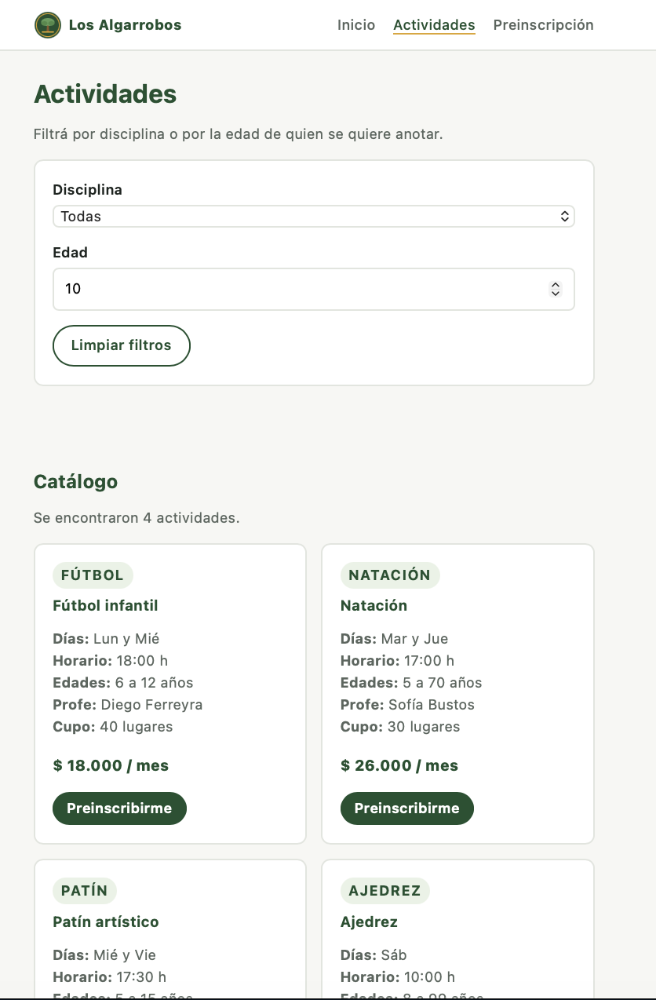
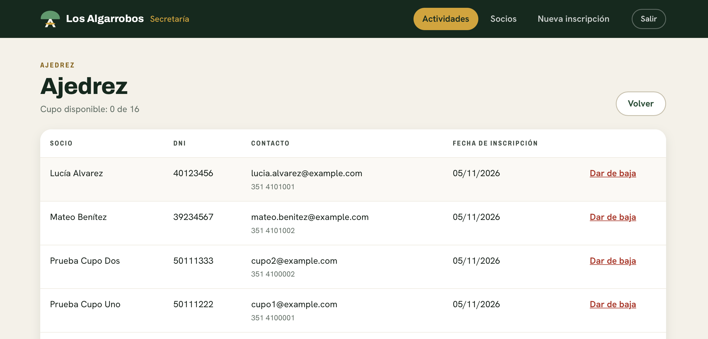
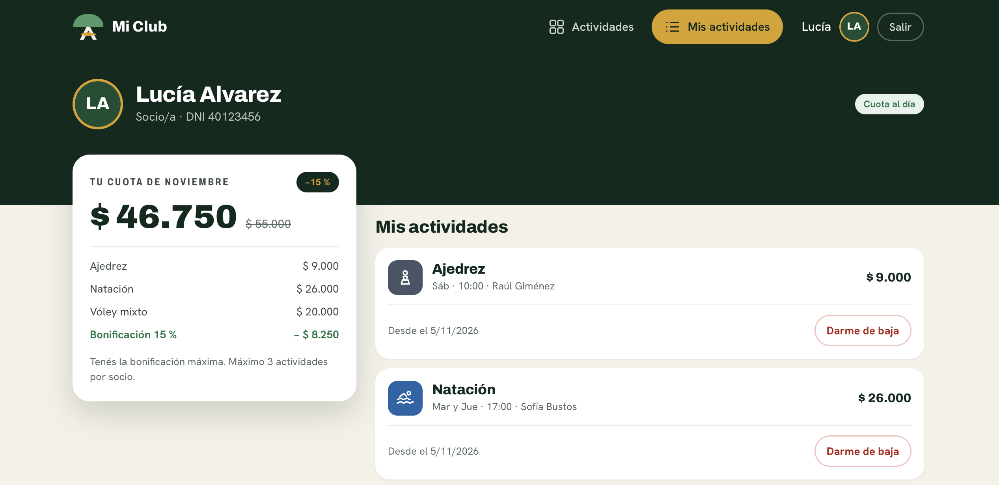
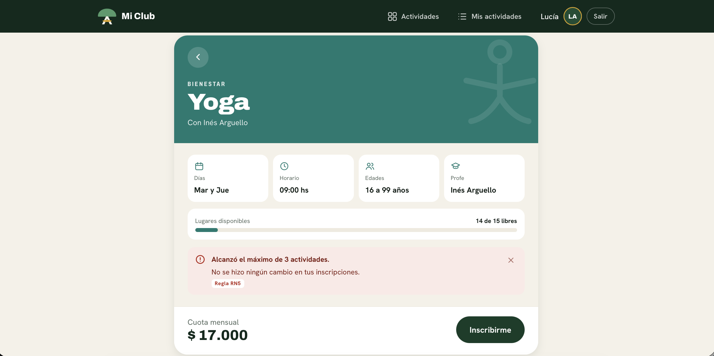

# SocioClub — Informe técnico

**Sistema web de gestión de socios, actividades e inscripciones**
Club Social y Deportivo Los Algarrobos · Córdoba

Trabajo Práctico Integrador · Taller de Construcción de Software · Universidad Siglo 21
Grupo N.º 6 · Cuatrimestre 2 de 2026

**Repositorio:** https://github.com/gabrandalisse/s21-tp-integrador-tcs

| Integrante | Parte principal |
|---|---|
| Gabriel Andrés Brandalisse | A — Sitio público del club |
| Pedro Mariano Cereghetti | B — Backoffice de secretaría y C — API REST |
| Mateo Baccillere | D — App "Mi Club" y pruebas de la app |
| Luciana Gallardo | E — Prueba de sistema y F — Documentación |

---

## 1. Descripción de la solución

El Club Los Algarrobos es un club de barrio de la zona norte de Córdoba con unos 650 socios y ocho actividades. Toda su gestión se hacía a mano: la secretaría anotaba las inscripciones en un cuaderno, los horarios se comunicaban por WhatsApp y las consultas llegaban por teléfono. De ahí salían los cinco problemas que la Comisión Directiva pidió resolver: cupos excedidos, inscripciones duplicadas, chicos fuera del rango de edad, socios con la cuota impaga que seguían anotándose, y vecinos sin forma de saber qué ofrece el club.

SocioClub los resuelve con tres caras sobre una sola base y un solo backend:

- **Sitio público** (`public/`): tres páginas donde el vecino ve las actividades con día, horario, edades, profesor y cuota, las filtra por disciplina y edad, y deja una preinscripción validada en el navegador.
- **Backoffice** (`backend/`, vistas Thymeleaf): la secretaría administra actividades y socios, inscribe gente y consulta los inscriptos de cada actividad con su cupo.
- **App "Mi Club"** (`app/`): el socio ingresa con su DNI, ve el catálogo, se anota, se da de baja y consulta su cuota estimada.

La decisión que sostiene el sistema es que las dos caras que escriben en la base **no duplican las reglas de negocio**: las dos atraviesan la misma capa de servicio, así que una inscripción se valida igual sin importar por dónde entró.

| Código | Requerimiento | Dónde se resuelve |
|---|---|---|
| RF1 | Mostrar las actividades con día, horario, edades, profesor y cuota | `public/pages/actividades.html` + `scripts/catalog.js` |
| RF2 | Filtrar por disciplina y por edad | Sitio público y app React (`utils/filtrarPorEdad.js`) |
| RF3 | Preinscripciones desde un formulario validado | `preinscripcion.html` + `scripts/signup.js` |
| RF4 | ABM y listado de actividades | `ActividadController` + `templates/actividades/` |
| RF5 | ABM de socios, con búsqueda por apellido y paginado | `SocioController` + `templates/socios/lista.html` |
| RF6 | Inscribir aplicando las reglas de negocio | `InscripcionService.inscribir()` |
| RF7 | Ver inscriptos activos y cupo disponible | `templates/actividades/inscriptos.html` |
| RF8 | Ingreso del socio con su DNI y sus inscripciones | `Ingreso.js` + `POST /api/socios/login` |
| RF9 | Baja de una actividad (lógica) | `InscripcionService.darDeBaja()` |
| RF10 | Cuota mensual estimada | `ResumenCuota.js` + `utils/calcularCuotaMensual.js` |

---

## 2. Arquitectura

```
 [ Vecino ]            [ Secretaría ]           [ Socio ]
  Sitio público (A)     Vistas Thymeleaf (B)     App React (D)
  HTML + CSS + JS              |                   | Axios (JSON)
                               v                   v
        +--------------------------------------------------+
        |       BACKEND SPRING BOOT (un proyecto Maven)    |
        |  controller/  MVC (B)   |  controller/api/ (C)   |
        |        +--------------------------------+        |
        |        |  service/   Reglas RN1 a RN5   |        |
        |        +--------------------------------+        |
        |  repository/  Spring Data JPA                    |
        |  model/       Entidades JPA                      |
        +-------------------------+------------------------+
                                  v
                        [ Base de datos MySQL ]
```

Cuatro paquetes, cuatro capas. **`model`** tiene las entidades JPA y los enumerados de estado, y es la única capa que conoce la forma de las tablas. **`repository`** son tres interfaces que extienden `JpaRepository`, sin implementación: Spring Data la genera en tiempo de ejecución a partir del nombre de cada método. **`service`** tiene la lógica de negocio, con las reglas RN1 a RN5. **`controller`** recibe los pedidos HTTP y devuelve una vista o un JSON, sin decidir nada.

Ninguna vista ni controlador llama al repositorio directamente, y la razón práctica se ve en este proyecto: hay **dos** controladores que crean inscripciones (`InscripcionController` para el backoffice y `ApiInscripcionController` para la app). Si la regla del cupo estuviera en el controlador habría que escribirla dos veces, y en la segunda copia se olvidaría alguna validación.

La inyección de dependencias es por constructor. Spring detecta las clases anotadas con `@Service`, `@Controller` y `@Repository`, crea una instancia de cada una (un *bean*) y se la pasa a quien la declare. Por eso `InscripcionController` nunca hace `new InscripcionService(...)`.

### 2.1 Recorrido completo de una inscripción

El camino del dato cuando el socio toca "Inscribirme":

1. **Clic** en `DetalleActividad.js`, que llama a `inscribirSocio(socio.id, actividad.id)`.
2. **`servicios/api.js`** arma el `POST /api/inscripciones` con `{ socioId, actividadId }` y lo envía con Axios. Ningún componente usa Axios directamente: todo pasa por este archivo.
3. **`ApiInscripcionController`** recibe el pedido; `@RequestBody` convierte el JSON en `CrearInscripcionRequest` y llama al servicio.
4. **`InscripcionService.inscribir()`** corre las cinco validaciones en orden. Si alguna falla, lanza `ReglaNegocioException` con el código de la regla.
5. **`InscripcionRepository.save()`** persiste la fila; Spring Data lo traduce a un `INSERT` y **MySQL** la guarda con `estado = 'ACTIVA'`.
6. **La respuesta** vuelve como `201 Created`, o como `409 Conflict` si saltó la excepción, porque `ApiExceptionHandler` la traduce. Con el 201 la pantalla recalcula la cuota y muestra la confirmación; con el 409 muestra el mensaje de la regla.

---

## 3. Modelo de datos

```
   Socio                   Inscripcion                  Actividad
   -----                   -----------                  ---------
   id            1 ----- N  id              N ----- 1    id
   dni (único)              fechaInscripcion             nombre (único)
   nombre                   estado                       disciplina
   apellido                 socio_id      (FK)           profesor
   fechaNacimiento          actividad_id  (FK)           dias / horario
   email / telefono                                      edadMinima / edadMaxima
   estadoCuota                                           cupoMaximo / cuotaMensual
```

Un socio puede anotarse en muchas actividades y una actividad tiene muchos socios. Esa relación de muchos a muchos **no** usa una tabla de unión automática, porque la inscripción tiene datos propios: la fecha y el estado. Por eso `Inscripcion` es una entidad con identidad propia, con dos `@ManyToOne` y su `@JoinColumn`; del otro lado, `Socio` y `Actividad` tienen `@OneToMany(mappedBy = "...")`, que le indica a JPA que la columna de la relación está en `inscripciones`. En la base son tres tablas, la última con las claves foráneas `socio_id` y `actividad_id`.

| Enumerado | Valores | Para qué |
|---|---|---|
| `EstadoCuota` | `AL_DIA`, `MOROSO` | Habilita o bloquea nuevas inscripciones (RN4) |
| `EstadoInscripcion` | `ACTIVA`, `BAJA` | Permite la baja lógica: la fila no se borra |

La baja es lógica por dos razones: el club quiere conservar el histórico, y todas las reglas cuentan **solo** las inscripciones `ACTIVA`, así que una baja libera el cupo y deja de contar para el máximo de tres sin perder el registro.

### 3.1 El ciclo infinito al serializar a JSON

Como `Socio` tiene una lista de `Inscripcion` y cada `Inscripcion` tiene un `Socio`, al convertir una entidad a JSON la serialización entra en un bucle hasta desbordar la pila. Es el problema que anticipa el Anexo B del enunciado y apareció al probar los primeros endpoints.

Se resolvió **no exponiendo nunca las entidades en la API**: cada endpoint devuelve un DTO del paquete `dto`, construido a mano con los campos que la pantalla necesita. `ActividadResponse` agrega `cupoDisponible`, que es calculado y no existe en la entidad; `InscripcionResponse` aplana la relación en `socioId`, `socioNombre`, `actividadId` y `actividadNombre`; `SocioResponse` deja afuera la lista de inscripciones. Al cortar la relación de ida y vuelta, el ciclo desaparece.

La alternativa era anotar la entidad con `@JsonIgnore`, pero eso mete una decisión de presentación dentro del modelo y deja la API atada a la forma exacta de las tablas: cualquier cambio en una entidad cambiaría el contrato sin que nadie lo decida.

---

## 4. Reglas de negocio

| Código | Regla | Implementación | Mensaje al rechazar |
|---|---|---|---|
| RN1 | Una actividad no puede superar su cupo máximo | `validarCupo()` | "La actividad no tiene cupo disponible." |
| RN2 | Un socio no puede tener dos inscripciones activas en la misma actividad | `validarDuplicado()` | "El socio ya está inscripto en esta actividad." |
| RN3 | La edad del socio debe estar en el rango de la actividad | `validarEdad()` | "La actividad es para personas de X a Y años." |
| RN4 | Un socio moroso no puede inscribirse | `validarCuota()` | "Debe regularizar su cuota en secretaría." |
| RN5 | Máximo 3 inscripciones activas por socio | `validarMaximoActividades()` | "Alcanzó el máximo de 3 actividades." |
| RN6 | 10 % de descuento con 2 actividades y 15 % con 3 | `utils/calcularCuotaMensual.js` | — (cálculo) |
| RN7 | DNI de 7 u 8 dígitos, sin puntos | `utils/esDniValido.js` y `scripts/signup.js` | "El DNI debe tener 7 u 8 números, sin puntos." |

RN1 a RN5 están las cinco en `InscripcionService`, que es lo que permite que valgan igual desde el backoffice y desde la app. RN6 y RN7 son cálculo y validación del lado del cliente, y por ser funciones puras se prueban con Jest sin montar ningún componente.

### 4.1 El orden de validación importa

`inscribir()` valida en este orden: **cupo → duplicado → edad → cuota → máximo**. La primera que falla corta la operación, así que el socio ve una sola regla por intento. Eso tiene una consecuencia al probar: si una actividad está completa, cualquier intento sobre ella devuelve RN1 aunque además el socio esté duplicado o sea moroso. Por eso en el capítulo 7 el caso de RN1 se corre **al final** y el de RN2 usa una actividad con cupo libre.

Sobre RN3: la edad no es un campo de la tabla. `validarEdad()` la deriva de la fecha de nacimiento con `Period.between(...)` cada vez, porque guardada como número quedaría desactualizada al día siguiente de cada cumpleaños.

---

## 5. La API REST

Los endpoints se publican bajo `/api` con `@RestController` y reutilizan la misma capa de servicio que el backoffice.

| Verbo | Ruta | Qué hace | Respuestas |
|---|---|---|---|
| GET | `/api/actividades` | Lista las actividades con su cupo. Acepta `?disciplina=` | 200 |
| GET | `/api/actividades/{id}` | Detalle de una actividad | 200 / 404 |
| POST | `/api/actividades` | Crea una actividad | 201 |
| PUT | `/api/actividades/{id}` | Modifica una actividad | 200 / 404 |
| DELETE | `/api/actividades/{id}` | Elimina una actividad sin inscriptos | 204 / 404 / 409 |
| POST | `/api/socios/login` | Ingreso del socio con `{ "dni", "clave" }` | 200 / 401 |
| GET | `/api/socios/dni/{dni}` | Busca un socio por DNI | 200 / 404 |
| GET | `/api/socios/{id}/inscripciones` | Inscripciones activas de un socio | 200 / 404 |
| POST | `/api/inscripciones` | Inscribe un socio. Aplica RN1 a RN5 | 201 / 404 / 409 |
| PUT | `/api/inscripciones/{id}/baja` | Baja lógica: estado a `BAJA` | 200 / 404 |

Los códigos no son genéricos. `201` devuelve además la cabecera `Location`. `204` responde al DELETE exitoso, que no tiene nada que devolver. `404` es "no existe ese id". Y `409 Conflict` está reservado para el pedido sintácticamente correcto que **una regla de negocio rechaza**, con el mensaje y el código de la regla en el cuerpo: `{ "error": "...", "regla": "RN1" }`. Ese campo `regla` es el que usa la app para distinguir qué pasó sin comparar textos.

La traducción de excepción a código HTTP está centralizada en `ApiExceptionHandler`, anotado con `@RestControllerAdvice`. Los controladores no capturan excepciones: dejan que suban y el manejador las convierte, lo que evita repetir el mismo `try/catch` en cada método.

**CORS.** La app se sirve desde `localhost:3000` y la API desde `localhost:8080`. Para el navegador son dos orígenes distintos —alcanza con que difiera el puerto—, así que por la política del mismo origen descarta la respuesta a menos que el servidor declare que ese origen está permitido. `CorsConfig` lo declara para `/api/**` con `allowedOrigins("http://localhost:3000")`. Sin esa configuración el pedido sale y el backend lo procesa, pero el navegador tira la respuesta: es un control del navegador, no del servidor.

La API es REST porque expone **recursos** identificados por URL, usa los **verbos HTTP** con su significado estándar en lugar de poner la acción en el nombre del endpoint, es **sin estado** y su representación es JSON. SOAP, en cambio, define un protocolo propio sobre un sobre XML, con contrato WSDL y una sola operación `POST` para todo.

---

## 6. Las tres caras del sistema

Las cuatro capturas se tomaron el 05/11/2026 con el sistema completo levantado.

### 6.1 Sitio público del club



El catálogo se arma con JavaScript a partir de un arreglo de objetos `Activity`. Con el filtro de edad en 10 años quedan las cuatro actividades que tienen esa edad dentro de su rango.

### 6.2 Sistema de secretaría



Los inscriptos de una actividad con su cupo disponible (RF7). Ajedrez aparece completo, 0 de 16, después del caso 7 de la prueba de sistema. Cada fila tiene la opción de dar de baja (RF9).

### 6.3 App "Mi Club"



Las inscripciones activas de la socia y su cuota estimada (RF10). Con tres actividades se aplica el 15 % de RN6: $ 55.000 de subtotal y $ 46.750 a pagar.

### 6.4 Una regla rechazando una operación



Lo que el enunciado pide demostrar en vivo. La socia ya tiene tres actividades activas y el servicio rechaza la cuarta: la app muestra el mensaje, el código `RN5` y la aclaración de que no se modificó ninguna inscripción.

---

## 7. Pruebas

### 7.1 Pruebas unitarias con Jest

Catorce pruebas sobre las funciones puras de `app/src/utils/`:

| Archivo | Casos |
|---|---|
| `calcularCuotaMensual.test.js` (RN6) | 0, 1, 2 y 3 actividades; argumento que no es un arreglo; cuotas que llegan como texto; porcentajes 0, 0, 10 y 15 |
| `esDniValido.test.js` (RN7) | DNI de 7 y 8 dígitos; con puntos; con letras; de 6 y de 9 dígitos; vacío, espacios y valores que no son texto |
| `filtrarPorEdad.test.js` (RF2) | Bordes del rango incluidos; filtro con 10 y con 22 años; sin edad devuelve todas; edades válidas de 1 a 99 |

Los bordes son el punto importante: en RN6 el salto de descuento está justo en 2 y 3 actividades, y en RN7 el límite está en 7 y 8 dígitos, así que se prueba con 6 y con 9 para confirmar dónde corta.

### 7.2 Pruebas de componente con React Testing Library

Seis pruebas con `render`, `screen` y `fireEvent`. Sobre `TarjetaActividad`: que muestre el nombre de la actividad y el profesor, que con cupo 0 muestre "Sin cupo" y deshabilite el botón, que con cupo 0 reciba la clase `tarjeta--sin-cupo`, y que con cupo disponible el clic llame a `onInscribir`. Sobre `ResumenCuota`: que sin actividades muestre `$ 0` y que con 2 muestre la bonificación del 10 %. `TarjetaActividad` se renderiza dentro de un `MemoryRouter` porque usa `<Link>`.

### 7.3 Pruebas de la API con Postman

La colección está en `backend/postman/`, con 24 solicitudes en tres carpetas: Actividades, Socios e Inscripciones. Incluye los casos exitosos, los 404 y uno por cada regla RN1 a RN5 con su `409`. Dos solicitudes marcadas como **preparación** no son casos de prueba: crean una actividad con `cupoMaximo: 1` y suman la tercera inscripción de un socio, para dejar los datos como RN1 y RN5 necesitan. Por eso se corre en orden y sobre una base recién creada.

**Resultado.** Las 24 solicitudes se corrieron el 05/11/2026 con el sistema levantado por Docker. **Las 24 devolvieron el código esperado** y, en los casos de regla, también el código de regla correcto. Los cinco rechazos por regla, copiados de la ejecución:

| Regla | Código | Cuerpo de la respuesta |
|---|---|---|
| RN1 | `409` | `{"error":"La actividad no tiene cupo disponible.","regla":"RN1"}` |
| RN2 | `409` | `{"error":"El socio ya está inscripto en esta actividad.","regla":"RN2"}` |
| RN3 | `409` | `{"error":"La actividad es para personas de 6 a 12 años.","regla":"RN3"}` |
| RN4 | `409` | `{"error":"Debe regularizar su cuota en secretaría.","regla":"RN4"}` |
| RN5 | `409` | `{"error":"Alcanzó el máximo de 3 actividades.","regla":"RN5"}` |

Los demás respondieron igual de bien: `404` para una actividad, un DNI y una inscripción inexistentes, `401` en el login con clave incorrecta, y `409` al eliminar una actividad con inscriptos. Dos detalles de la corrida: el mensaje de RN3 informa el rango de **la actividad**, no la edad del socio, que es lo que pide la regla; y la baja devolvió la fila con `"estado":"BAJA"` conservando su fecha original, que es la diferencia entre una baja lógica y un `DELETE`.

### 7.4 Prueba de sistema

Ocho casos de punta a punta, con MySQL, el backend y la app React levantados.

**Orden.** Los casos van en el orden de la tabla, que no es el de las reglas: el de RN1 va último porque deja Ajedrez completa, y desde ahí cualquier intento sobre Ajedrez devuelve RN1 antes que cualquier otra regla (ver 4.1). Por eso el de RN2 usa Natación, con cupo libre.

**Datos de partida:** base recién creada con `data.sql` — ocho actividades, quince socios (dos morosos) y los quince inscriptos en Ajedrez, que queda en 15 de 16.

| # | Caso | Pasos | Resultado esperado | Resultado obtenido |
|---|---|---|---|---|
| 1 | **Inscripción exitosa** | Ingresar con DNI `39234567` (Mateo, al día), filtrar por "Bienestar", abrir Yoga e "Inscribirme". | `201`. Confirmación con la cuota recalculada. En "Mis actividades" figuran Ajedrez y Yoga. En el backoffice Yoga baja de 15 a 14. | **Como se esperaba.** "Quedaste inscripto/a en Yoga", cuota $ 23.400 con −10 %. En el backoffice, "14 disponibles de 15". |
| 2 | **RN6 · Bonificación** | Con el mismo socio, ir a "Mis actividades" y revisar el resumen con 2 actividades. | Ajedrez ($ 9.000) + Yoga ($ 17.000) − 10 % = **$ 23.400**, con la insignia −10 % y el subtotal tachado. | **Como se esperaba.** Desglose $ 9.000 + $ 17.000, "Bonificación 10 % −$ 2.600" y total **$ 23.400** sobre $ 26.000. |
| 3 | **RN5 · Máximo 3** | Ingresar con DNI `40123456` (Lucía, ya en Ajedrez), inscribirse en Natación y Vóley, e intentar Yoga. | Las dos primeras dan `201`. La tercera se rechaza con **"Alcanzó el máximo de 3 actividades."** La cuota pasa a 15 %. | **Como se esperaba.** Cuota en $ 31.500 (−10 %) y después $ 46.750 sobre $ 55.000 (−15 %). El cuarto intento: el mensaje con la etiqueta "Regla RN5". |
| 4 | **RN2 · Duplicada** | Con la misma socia, abrir Natación, donde ya quedó inscripta, e "Inscribirme". | Se rechaza con **"El socio ya está inscripto en esta actividad."** Los inscriptos de Natación no cambian. | **Como se esperaba.** El mensaje con la etiqueta "Regla RN2". Natación siguió en "29 de 30 libres". |
| 5 | **RN3 · Edad** | Ingresar con DNI `48934567` (Bruno, 17 años), abrir Funcional adultos (18 a 65) e "Inscribirme". | La pantalla avisa antes del clic. Al confirmar se rechaza indicando el rango: **"La actividad es para personas de 18 a 65 años."** | **Como se esperaba.** Aviso previo "Tenés 17 años y esta actividad es para 18 a 65 años." y rechazo con el rango, etiqueta "Regla RN3". |
| 6 | **RN4 · Cuota impaga** | Ingresar con DNI `42145678` (Sofía, morosa), intentar Natación y después darse de baja de Ajedrez. | Se rechaza con **"Debe regularizar su cuota en secretaría."** La baja sí funciona: un moroso puede consultar y darse de baja. | **Como se esperaba.** Rechazo con la etiqueta "Regla RN4". La baja funcionó: cuota a $ 0, mensaje de lista vacía, y el cupo de Ajedrez subió de 1 a 2. |
| 7 | **RN1 · Sin cupo** | En el backoffice, crear tres socios al día (`50111222`, `50111333`, `50111444`). Inscribir a los dos primeros en Ajedrez: la baja del caso 6 dejó dos lugares, así que llega a 16 de 16. Intentar con el tercero. | Las dos primeras entran y el cupo baja a 1 y después a 0. La tercera se rechaza con **"La actividad no tiene cupo disponible."** En la app la tarjeta pasa a gris, "Sin cupo", con el botón deshabilitado. | **Como se esperaba.** Cupo en "1 de 16" y después "0 de 16". Tercer intento rechazado. En la app, insignia "Sin cupo", clase `tarjeta--sin-cupo` y botón `disabled`. |
| 8 | **RN7 · DNI inválido** | Escribir `40.123.456` en el ingreso de la app, y enviar vacío el formulario de preinscripción del sitio público. | No se envía y el error aparece junto al campo, no con `alert()`. No sale ningún pedido al backend. | **Como se esperaba.** "El DNI debe tener 7 u 8 dígitos numéricos, sin puntos." junto al campo, sin salir de `/`. En el sitio público, los siete errores uno por campo. |

**Los 8 casos se comportaron como se esperaba**, sin ninguna diferencia respecto de lo previsto. La tabla tiene ocho filas y no seis porque, además del caso exitoso y de RN1 a RN5 que pide el enunciado, se agregaron RN6, que es lo que el socio ve en pantalla, y RN7, la única regla que se valida sin llegar al backend.

Tres cosas que la corrida dejó en claro:

- **La baja lógica libera el cupo.** Al darse de baja Sofía en el caso 6, Ajedrez pasó de 1 a 2 lugares, y por eso el caso 7 necesita **dos** socios nuevos y no uno. Es consecuencia directa de que `contarActivasPorActividad` cuente solo las `ACTIVA`.
- **La app anticipa el rechazo pero no reemplaza la validación.** En los casos 5 y 6 la pantalla avisa de antemano, pero el botón sigue habilitado y el rechazo lo produce el servicio. Lo único que deshabilita el botón es la falta de cupo: la pantalla orienta, el backend decide.
- **El rechazo no deja rastro.** En los cuatro casos de error aparece "No se hizo ningún cambio en tus inscripciones." y los cupos quedaron intactos, lo que confirma que la excepción corta antes del `save()`.

> Para volver a correr la prueba hay que dejar la base en su estado inicial: tanto la colección de Postman como esta prueba modifican los datos. Con el sistema parado, `docker compose down -v` borra el volumen de MySQL y el siguiente arranque recarga `data.sql`.

---

## 8. Conclusiones

El club llegó con cinco problemas, y cuatro tienen hoy una regla que los hace imposibles, no una advertencia que se pueda ignorar: los cupos excedidos, las duplicadas, las edades fuera de rango y los morosos quedaron cubiertos por RN1 a RN5, verificadas una por una. El quinto, la falta de información pública, lo resuelve el sitio. Que la secretaría ya no tenga que acordarse de revisar si un chico tiene la edad o si el cupo está lleno es el resultado que más vale: el sistema no le avisa, directamente no la deja.

La decisión de la que más aprendimos fue poner las reglas en la capa de servicio. Al principio parecía una formalidad del enunciado, una manera de ordenar carpetas. Entendimos para qué servía al construir la Parte C: los controladores REST se escribieron reutilizando `InscripcionService` y **no hubo que escribir ni una validación de nuevo**. La prueba de sistema lo confirmó: el mismo mensaje lo devuelve el backoffice y lo devuelve la API, porque es literalmente el mismo método Java. Si esa regla hubiera estado en el controlador, hoy tendríamos dos copias y la segunda estaría incompleta.

Lo que más costó fueron dos cosas, y las dos aparecieron al ejecutar, no al leer. La primera, el ciclo infinito al convertir las entidades a JSON, que nos obligó a entender por qué una relación de ida y vuelta rompe la serialización. La segunda, el orden de las validaciones: cuando una socia se dio de baja de Ajedrez, la actividad pasó de un lugar libre a dos y el caso de prueba que teníamos escrito dejó de funcionar. Ahí entendimos que, como el cupo se valida primero, una actividad completa devuelve RN1 aunque el socio además esté duplicado o sea moroso. Tuvimos que reescribir el caso, y de paso entendimos el sistema mejor que leyéndolo.

También sabemos qué quedó afuera. La preinscripción del sitio público valida bien pero no persiste: muestra una confirmación y ahí termina, así que la secretaría todavía no la recibe. El catálogo público tiene las ocho actividades escritas en un arreglo de JavaScript, de modo que si la secretaría cambia un horario o una cuota, el vecino sigue viendo el valor viejo. El ingreso usa el DNI como contraseña y sin hashear. Y el máximo de tres está escrito como un número suelto en el servicio en lugar de ser configurable. Si tuviéramos un cuatrimestre más, lo primero sería que el sitio público consuma la API: es el único lugar donde el dato que ve el vecino puede no ser el que está en la base.

---

## 9. Bitácora de uso de inteligencia artificial

| N.º | Parte | Qué le pedimos | Qué nos devolvió | Qué estaba mal / qué cambiamos y por qué |
|---|---|---|---|---|
| 1 | B | Generar las entidades JPA con sus relaciones. | Las tres entidades con `@ManyToOne` y `@OneToMany` correctos, pero usando Lombok para evitar escribir getters y setters. | Sacamos Lombok: no se vio en la materia y no podríamos explicar de dónde salen métodos que no están escritos. Los escribimos a mano. También agregamos el enumerado `EstadoInscripcion`, que no había incluido: su versión borraba la inscripción en lugar de darla de baja lógicamente. |
| 2 | C | Exponer las entidades en los endpoints REST. | Controladores que devolvían las entidades JPA directamente. | Al probar `GET /api/socios/dni/{dni}` el servidor entró en un ciclo infinito: el socio serializaba sus inscripciones y cada inscripción su socio. La IA propuso resolverlo con `@JsonIgnore`; lo descartamos porque mete una decisión de presentación dentro del modelo, y creamos el paquete `dto`. De paso, `ActividadResponse` pudo incluir `cupoDisponible`, que es calculado y no una columna. |
| 3 | B | Un login para que la secretaría no entre sin autenticarse. | Una configuración con Spring Security, `SecurityFilterChain` y BCrypt. | No lo usamos: Spring Security no se vio en la materia y el enunciado avisa que lo que no podamos explicar cuenta como incumplimiento. Lo reemplazamos por `SecretariaService` con `@Value`, una marca en la sesión HTTP y `SesionInterceptor`, que sí podemos defender línea por línea. Queda documentado que en un sistema real la contraseña iría hasheada. |
| 4 | D | Crear la app de socios con React Router, estado y consumo de la API. | Un proyecto inicializado con Vite y los pedidos hechos con `fetch`. | Cambiamos las dos cosas: rehicimos el proyecto con `create-react-app`, que es lo del Módulo 3, y pasamos todo a Axios. Además centralizamos las llamadas en `src/servicios/api.js`: la primera versión tenía el `fetch` suelto en cada componente, así que al cambiar la URL base hubo que tocar seis archivos. |
| 5 | D | Pasar el socio logueado a las pantallas que lo necesitan. | El socio pasado por props desde `App` hacia cada hijo. | Funcionaba, pero `DetalleActividad` recibía el socio solo para pasarlo hacia abajo sin usarlo. Lo reemplazamos por `createContext` / `useContext`, que es lo que pide el enunciado y lo que corresponde para un dato que necesitan pantallas de distintos niveles. |
| 6 | E | Armar la colección de Postman con los endpoints y los casos de error. | Una colección con los endpoints del Anexo A y una solicitud por regla. | Tenía dos errores que encontramos al correrla: usaba variables como `{{socioParaCupoId}}` que nunca estaban definidas, así que cinco solicitudes se enviaban con el texto literal en el cuerpo; y los cuerpos de RN1 y RN5 estaban mal formados, les faltaba la llave de cierre, y devolvían `400` en lugar de `409`. Al corregirlo apareció el problema de fondo: RN1 no se podía reproducir por API, porque Ajedrez tiene un solo lugar libre y la API no tiene endpoint para crear socios. Lo resolvimos con dos solicitudes de preparación. |

### 9.1 Reflexión sobre el uso de la herramienta

Mirando las seis entradas juntas aparece un patrón: en cuatro de las seis la herramienta propuso algo más moderno o más cómodo que lo visto en la materia —Lombok, Spring Security, Vite, `fetch`—. Ninguna de esas propuestas es mala en sí misma; en un proyecto real varias serían la opción correcta. Las reemplazamos igual, y no por capricho del enunciado: el criterio de esta entrega es poder explicar cada línea, y Lombok genera métodos que no están escritos en ningún lado. Si en la defensa nos preguntan de dónde sale `getNombre()`, "lo agrega una anotación" no alcanza. Elegir una herramienta no es solo evaluar si funciona, sino si el equipo puede hacerse cargo de ella.

El segundo patrón es el aprendizaje más útil: **los errores no aparecieron leyendo, aparecieron ejecutando**. El código que exponía las entidades se veía razonable y compilaba sin una advertencia; el ciclo infinito apareció recién al pedir un socio por DNI. La colección de Postman se veía completa, con su carpeta por recurso y un caso por regla, y tenía siete variables sin definir y dos cuerpos JSON sin cerrar. Nada de eso se nota mirando: se nota cuando corrés las 24 solicitudes y cinco fallan. La IA produce algo plausible muy rápido, y lo plausible es justamente lo que cuesta revisar, porque no tiene el aspecto de estar mal. De ahí salió nuestra forma de trabajo: pedirle que explique lo que generó, reescribir a mano lo que no podíamos explicar, y no dar nada por bueno hasta haberlo ejecutado. Por eso las reglas se terminaron probando de tres maneras distintas —JUnit sobre el servicio, Postman sobre la API y a mano sobre la interfaz—: son el corazón del sistema y cada nivel puede fallar sin que el otro se entere.

---

## Anexo · Cómo levantar el proyecto

Las instrucciones completas están en el [`README.md`](../README.md) del repositorio: creación de la base, backend con Maven o con Docker, app React y usuarios de prueba.
